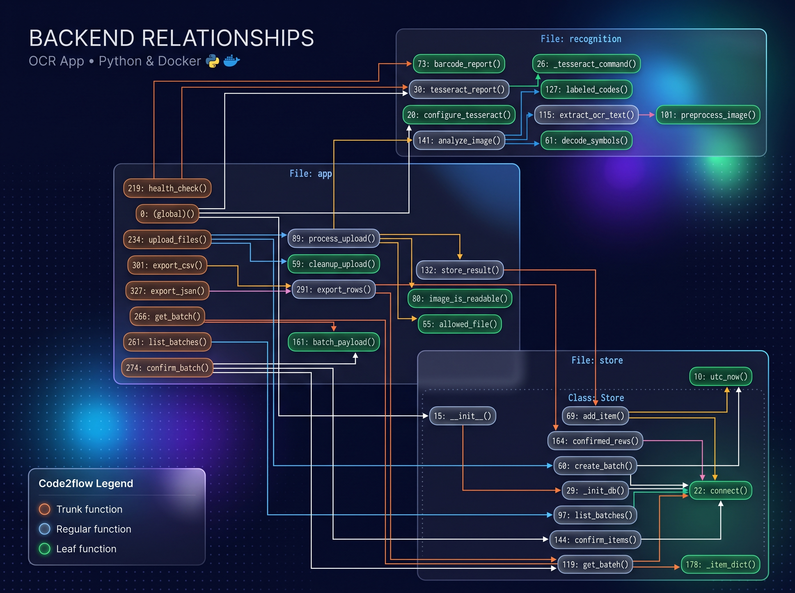
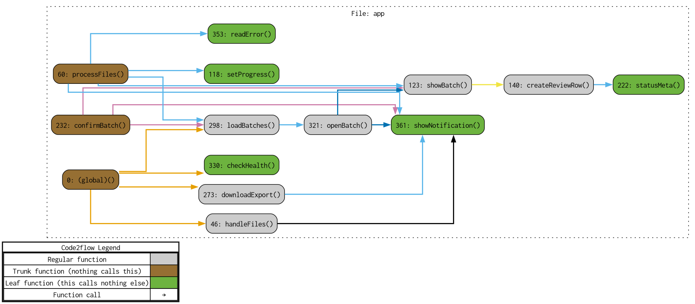

# Inventory OCR Scanner

Una aplicación web para leer códigos de inventario desde fotografías, revisarlos y exportar el lote confirmado. Usa decodificación de códigos de barras y QR, con Tesseract solo como respaldo para etiquetas de texto. Está hecha con Python, Flask y Docker.

## Diagramas de llamadas

Generados con [code2flow](https://github.com/scottrogowski/code2flow) a partir del código del repositorio.

### Backend



El grafo conecta la carga (`upload_files`), la lectura (`analyze_image`, `decode_symbols`, `extract_ocr_text`), la revisión (`confirm_batch`) y la exportación CSV/JSON con el almacén SQLite.

### Frontend



El grafo del navegador muestra la subida con progreso real, la fila de revisión y la exportación del lote guardado.

## Características

- ✅ **Carga múltiple de imágenes** - Cada archivo queda como aceptado, sin lectura o rechazado
- ✅ **Código de barras y QR** - La lectura principal usa un decodificador, no una expresión regular
- ✅ **OCR de respaldo** - Tesseract solo propone códigos con etiqueta (SKU, serie, código)
- ✅ **Revisión** - El operador corrige o descarta cada fila antes de guardarla
- ✅ **Historial** - Los lotes quedan en SQLite y siguen ahí después de recargar
- ✅ **Exportación** - CSV y JSON salen de las filas confirmadas
- ✅ **Salud del OCR** - `/api/health` falla si Tesseract o el decodificador no están disponibles
- ✅ **Un operador** - Clave local, secreto distinto del de desarrollo y limpieza de `uploads/`

## Tecnologías Utilizadas

### Backend
- **Python 3.11** - Lenguaje principal
- **Flask 2.3.3** - Framework web ligero
- **OpenCV 4.8.1** - Procesamiento de imágenes
- **Pytesseract 0.3.10** - OCR gratuito
- **Pillow 10.0.0** - Manipulación de imágenes

### Frontend
- **Tailwind CSS** - Framework de estilos
- **Anime.js** - Animaciones suaves
- **Font Awesome** - Iconos profesionales
- **Vanilla JavaScript** - Sin dependencias pesadas

### Infraestructura
- **Docker** - Contenedorización
- **Nginx** - Servidor web reverso
- **Gunicorn** - Servidor WSGI para producción

## Instalación y Uso

### Opción 1: Docker (Recomendado)

1. **Clonar el repositorio:**
```bash
git clone https://github.com/HugoFernandoColmenares/OCRDockerApp.git
cd OCRDockerApp
```

2. **Construir y ejecutar con Docker Compose:**
```bash
docker compose up --build
```

El servicio escucha con Gunicorn. En este compose local la clave de operador es `ocr-local`. Antes de exponer el servicio, define `SECRET_KEY` y `APP_PASSWORD` en el entorno; con `FLASK_ENV=production` la aplicación no arranca si el secreto sigue siendo el de desarrollo o si no hay clave.

3. **Acceder a la aplicación:**
- Aplicación principal: http://localhost:8000
- A través de Nginx: http://localhost
- Salud: http://localhost:8000/api/health

4. **Comprobar el flujo:**
```bash
docker compose run --rm --no-deps ocr-app python tests/smoke_test.py
```

### Opción 2: Instalación Manual

1. **Instalar dependencias del sistema:**
```bash
# Ubuntu/Debian
sudo apt-get update
sudo apt-get install tesseract-ocr tesseract-ocr-spa libtesseract-dev

# macOS
brew install tesseract
```

2. **Instalar dependencias de Python:**
```bash
pip install -r requirements.txt
```

3. **Ejecutar la aplicación:**
```bash
python app.py
```

## Uso de la Aplicación

### Paso 1: Entrar
Abre la aplicación e introduce la clave de operador.

### Paso 2: Cargar imágenes
- Arrastra y suelta las fotografías de inventario
- O haz clic para seleccionar archivos
- Formatos soportados: PNG, JPG, JPEG, GIF, BMP, TIFF, WEBP
- La barra de progreso sigue la subida real. Al llegar al 100 % el servidor todavía está leyendo las imágenes.

### Paso 3: Revisar
Cada imagen muestra un estado:

- **Aceptada**: hay un código propuesto (barras/QR con confianza alta, o una etiqueta OCR con confianza baja)
- **Sin lectura**: el archivo es una imagen, pero no hay un código utilizable
- **Rechazada**: la extensión o el contenido no es una imagen

Corrige el código, o marca la fila como descartada, y pulsa **Confirmar lote**. Hasta ese momento la fila no entra en la exportación. El lote queda en SQLite y vuelve a aparecer en **Lotes recientes** después de recargar.

### Paso 4: Exportar
Con el lote confirmado, descarga CSV o JSON. El CSV trae `filename`, `code_type`, `raw_value`, `corrected_value`, `timestamp` y `status`.

## Estructura del Proyecto

```
OCRDockerApp/
├── app.py                 # Rutas Flask, sesión y exportación
├── recognition.py         # Códigos de barras, QR y OCR
├── store.py               # Lotes en SQLite
├── tests/smoke_test.py    # Prueba de humo dentro de Docker
├── templates/             # Login e interfaz
├── static/app.js          # Revisión y progreso de subida
├── docs/screenshots/      # Grafos de code2flow
├── data/                  # Base SQLite (no se versiona)
└── uploads/               # Imágenes temporales, con límite de retención
```

## Formato de Resultados JSON

La exportación JSON sale de las filas confirmadas:

```json
[
  {
    "filename": "producto1.jpg",
    "code_type": "barcode",
    "raw_value": "ABC123456",
    "corrected_value": "ABC123456",
    "timestamp": "2026-10-13T16:53:28",
    "status": "accepted"
  }
]
```

## Tipos de códigos

- **Código de barras o QR**: lo devuelve el decodificador y se propone con confianza alta
- **SKU, serie o código de producto**: solo si el texto OCR trae una etiqueta (`SKU`, `SERIAL`, `SERIE`, `CODIGO`, `CODE`, `ITEM`)
- Un precio o un número suelto no se guarda como código de inventario

## Configuración Avanzada

### Variables de Entorno

- `SECRET_KEY`: obligatorio en producción y distinto de `dev-secret-key-change-in-production`
- `APP_PASSWORD`: clave del operador; obligatoria en producción
- `TESSERACT_CMD`: ruta del binario si no está en `/usr/bin/tesseract`
- `OCR_LANGUAGE`: idiomas de Tesseract, por defecto `spa+eng`
- `DATABASE_PATH`: archivo SQLite, por defecto `data/inventory.db`
- `MAX_STORED_UPLOADS` y `UPLOAD_MAX_AGE_DAYS`: tope y antigüedad de `uploads/`

### Optimización del OCR

La aplicación incluye preprocesamiento de imágenes para mejorar la precisión:

- Conversión a escala de grises
- Filtro de desenfoque gaussiano
- Umbral adaptativo
- Operaciones morfológicas

## Solución de Problemas

### Error: Tesseract no encontrado
```bash
# Verificar instalación
tesseract --version

# En Docker, ya está incluido
```

### Error: Archivos grandes
- Asegúrate de que los archivos sean menores a 16MB
- Considera comprimir las imágenes si son muy grandes

### Error: Memoria insuficiente
- Aumenta la memoria disponible para Docker
- Procesa menos imágenes simultáneamente

## Contribuciones

Las contribuciones son bienvenidas. Por favor:

1. Haz fork del proyecto
2. Crea una rama para tu feature
3. Commit tus cambios
4. Push a la rama
5. Crea un Pull Request

## Licencia

Este proyecto está licenciado bajo la Licencia MIT. Ver el archivo LICENSE para más detalles.

## Soporte

Para reportar problemas o solicitar características:

- 📧 Email: soporte@inventory-ocr.com
- 🐛 Issues: https://github.com/tu-usuario/inventory-ocr-scanner/issues
- 📖 Wiki: https://github.com/tu-usuario/inventory-ocr-scanner/wiki

---

**Desarrollado con ❤️ por el equipo de Inventory OCR Scanner**